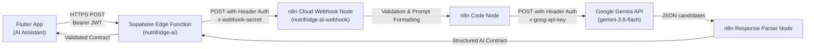

# NutriFridge AI Assistant — n8n Cloud Deployment Guide

This guide describes how to import, configure, and run the NutriFridge AI Assistant workflow on **n8n Cloud** (`https://<instance>.app.n8n.cloud/`).

---

## 1. Architecture Overview



- **Workflow File:** `n8n/workflows/nutrifridge-ai-assistant.json`
- **Default AI Model:** `gemini-3.8-flash` (`https://generativelanguage.googleapis.com/v1beta/models/gemini-3.8-flash:generateContent`)
- **No Server Environment Variables Needed:** n8n Cloud manages all secrets through encrypted credentials in the n8n Credentials Manager.

---

## 2. Step 1: Import the Workflow into n8n Cloud

1. Log in to your n8n Cloud dashboard (e.g., `https://your-instance.app.n8n.cloud/`).
2. Go to **Workflows** in the sidebar.
3. Click the **⋮ (three dots)** menu in the upper-right corner and select **Import from File**.
4. Upload `n8n/workflows/nutrifridge-ai-assistant.json` (or copy and paste its JSON content into the canvas).
5. The workflow appears with 10 nodes:
   - `Webhook — NutriFridge AI`
   - `Validate Request & Auth Secret`
   - `IF — Request & Secret Valid?`
   - `Respond to Webhook — Auth/Validation Error`
   - `Prepare Context & Gemini Prompt`
   - `Call Google Gemini API`
   - `Parse & Validate Gemini Output`
   - `IF — Gemini Output Valid?`
   - `Respond to Webhook — Success`
   - `Respond to Webhook — Upstream Error`

---

## 3. Step 2: Configure n8n Cloud Credentials

You need to create **two Header Auth credentials** in n8n Cloud:

### Credential 1: NutriFridge Webhook Secret (Webhook Node)
Protects the Webhook node from unauthorized calls. Only requests containing this header will be accepted; unauthenticated calls are rejected with `401 Unauthorized`.

1. In the n8n Cloud left sidebar, go to **Credentials** → **Add Credential**.
2. Search for **Header Auth** and select it.
3. Configure the fields:
   - **Credential Name:** `NutriFridge Webhook Secret`
   - **Name:** `x-webhook-secret`
   - **Value:** `<YOUR_SHARED_SECRET>` (e.g. a random 32-character string)
4. Click **Save**.
5. Open the imported workflow, double-click the **`Webhook — NutriFridge AI`** node:
   - Verify **Authentication** is set to **Header Auth**.
   - Under **Credential for Header Auth**, select `NutriFridge Webhook Secret`.
   - Save the node.

### Credential 2: Google Gemini API Key (HTTP Request Node)
Authenticates requests from n8n to Google's Gemini API without exposing the key in the workflow JSON or client code.

1. Obtain an API key from [Google AI Studio](https://aistudio.google.com/).
2. In the n8n Cloud sidebar, go to **Credentials** → **Add Credential**.
3. Search for **Header Auth** and select it.
4. Configure the fields:
   - **Credential Name:** `Google Gemini API Key`
   - **Name:** `x-goog-api-key`
   - **Value:** `<YOUR_GOOGLE_AI_STUDIO_API_KEY>`
5. Click **Save**.
6. Open the imported workflow, double-click the **`Call Google Gemini API`** node:
   - Verify **Authentication** is set to **Generic Credential Type**.
   - Verify **Generic Auth Type** is set to **Header Auth**.
   - Under **Credential for Header Auth**, select `Google Gemini API Key`.
   - Save the node.

---

## 4. Step 3: Activate Workflow and Note Webhook URL

1. In the top right corner of the workflow editor, toggle the workflow switch to **Active**.
2. Double-click the **`Webhook — NutriFridge AI`** node to copy the Production Webhook URL:
   `https://<your-instance>.app.n8n.cloud/webhook/nutrifridge/ai`

---

## 5. Step 4: Link with Supabase Edge Function

In your Supabase project (Dashboard → **Edge Functions** → **nutrifridge-ai** → **Secrets**, or via Supabase CLI):

```bash
supabase secrets set N8N_WEBHOOK_URL="https://<your-instance>.app.n8n.cloud/webhook/nutrifridge/ai"
supabase secrets set N8N_WEBHOOK_SECRET="<THE_SAME_SHARED_SECRET_USED_IN_CREDENTIAL_1>"
```

The Supabase Edge Function automatically forwards this secret via the `x-webhook-secret` header when calling your n8n Cloud webhook.

---

## 6. Key Guardrails Preserved

- **Grounding on Authoritative Inventory:** Gemini only recommends or deducts ingredients found in the current fridge inventory; unlisted ingredients are marked as `missingIngredients`.
- **11 Canonical Categories:** Responses strictly enforce NutriFridge's 11 database categories (`Dairy Products`, `Vegetables`, `Fruits`, `Non-Veg`, `Meals & Leftovers`, `Packaged Food`, `Drinks & Juices`, `Ice Cream`, `Frozen Food`, `Dry Fruits`, `Others`).
- **Explicit Confirmation for Deductions:** All ingredient deductions require explicit user confirmation (`requiresConfirmation: true`, `deductionNeedsUserConfirmation: true`).
- **Approximate Nutrition Estimates:** Calorie and macronutrient estimates are flagged with `isEstimate: true`.
