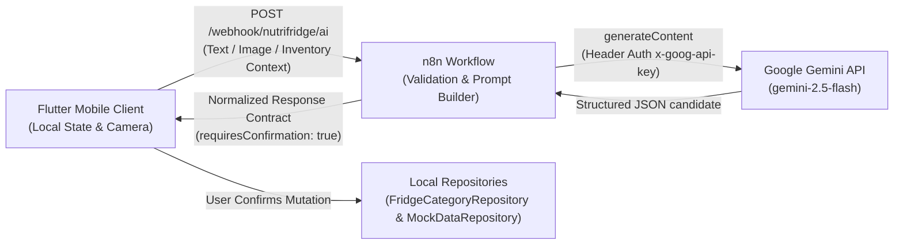

# NutriFridge AI Backend — n8n Workflow Integration Guide

**Workflow Version:** 1.0.0  
**Workflow File:** [`NutriFridge_AI_Backend.json`](./NutriFridge_AI_Backend.json)  
**Target Engine:** n8n (Community or Enterprise, v1.0.0+)  
**AI Foundation:** Google Gemini REST API (`gemini-2.5-flash` via Google AI Studio)  
**Client:** NutriFridge Flutter Mobile Application  

---

## 1. Architectural Role & Boundary

The `NutriFridge_AI_Backend` n8n workflow functions strictly as an **AI interpretation, vision recognition, and natural-language structuring layer**. 

> [!IMPORTANT]
> **No Database or Persistent Storage:** This workflow **does NOT** store, write, or persist data to any external database (no Supabase, PostgreSQL, Firebase, Redis, or Google Sheets). The Flutter application's in-memory repositories (`FridgeCategoryRepository`, `MockDataRepository`, `NotificationRepository`) remain the authoritative single source of truth for the session.



---

## 2. Source-Grounded Domain Contracts

### 2.1 The 11 Canonical Refrigerator Categories
Gemini is constrained by system instructions to output **only** the 11 categories accepted by `FridgeCategoryRepository`:

1. `Dairy Products` (Milk, Paneer, Curd, Yogurt, Butter, Cheese)
2. `Vegetables` (Tomato, Carrot, Broccoli, Capsicum, Spinach)
3. `Fruits` (Apple, Banana, Orange, Grapes)
4. `Non-Veg` (Eggs, Chicken, Fish, Seafood)
5. `Meals & Leftovers` (Paneer Curry, Dal Rice, Pasta, Leftovers)
6. `Packaged Food` (Bread, Peanut Butter, Jam, Cereal)
7. `Drinks & Juices` (Orange Juice, Apple Juice, Water)
8. `Ice Cream` (Vanilla Ice Cream, Chocolate Ice Cream)
9. `Frozen Food` (Frozen Peas, Frozen Corn, French Fries)
10. `Dry Fruits` (Almonds, Cashews, Raisins, Mixed Nuts)
11. `Others` (Honey, Chocolate, Miscellaneous condiments)

### 2.2 Client In-Memory Repositories (Flutter)
- **`FridgeCategoryRepository`** (`lib/screens/fridge/models/category_item.dart`):
  - `addItemToCategory(String categoryName, CategoryFoodItem item)`
  - `addMultipleItems(List<MapEntry<String, CategoryFoodItem>> entries)`
  - `updateItem(String categoryIdOrName, CategoryFoodItem updatedItem)`
  - `removeItem(String categoryIdOrName, String itemId)`
- **`MockDataRepository`** (`lib/models/nutrition_data.dart`):
  - `logMeal({required String mealType, required String mealName, required int calories, required int protein, required int carbs, required int fat, List<String>? ingredients})`
  - Manages `DailyNutritionData` and `Today's Meals`.
- **`NotificationRepository`** (`lib/models/notification_data.dart`):
  - `addNotification({required String title, required String description, required NotificationType type})`
- **`AppImagePicker`** (`lib/core/services/app_image_picker.dart`):
  - Handles physical camera and gallery photo picking.

---

## 3. Workflow Import & Setup Instructions

### Step 1: Import Workflow into n8n
1. Open your n8n web interface (e.g. `http://localhost:5678`).
2. Navigate to **Workflows** in the left sidebar.
3. Click the **three dots menu (⋮)** in the top right corner and select **Import from File**.
4. Choose [`NutriFridge_AI_Backend.json`](./NutriFridge_AI_Backend.json).
5. The workflow canvas will populate with 9 connected nodes:
   - `Webhook — NutriFridge AI`
   - `Validate and Normalize Request`
   - `IF — Request Valid?`
   - `Respond to Webhook — Validation Error`
   - `Build Gemini Request`
   - `HTTP Request — Gemini generateContent`
   - `Parse and Validate Gemini Response`
   - `IF — Gemini Processing Succeeded?`
   - `Respond to Webhook — Success`
   - `Format and Respond to Upstream Error`

### Step 2: Configure Gemini API Credentials (Header Auth)
1. Obtain an API key from [Google AI Studio](https://aistudio.google.com/).
2. In n8n, go to **Credentials** → **New Credential**.
3. Search for **Header Auth** and click **Create**.
4. Configure the credential:
   - **Credential Name:** `Google AI Studio Header Auth (x-goog-api-key)`
   - **Header Name:** `x-goog-api-key`
   - **Header Value:** `<PASTE_YOUR_GEMINI_API_KEY_HERE>`
5. Save the credential.
6. Return to the imported workflow, double-click the **`HTTP Request — Gemini generateContent`** node, and select this credential under **Authentication** → **Credential for Header Auth**.

> [!CAUTION]
> **Secret Protection:** Never commit or hardcode your Gemini API key inside `NutriFridge_AI_Backend.json` or Flutter source code. n8n safely encrypts the key in its internal credential database.

### Step 3: Activate the Workflow
1. Toggle the **Active** switch in the top right corner to **ON**.
2. Note the Webhook URLs generated by n8n:
   - **Test Webhook URL:** `https://dynamo008.app.n8n.cloud/webhook-test/nutrifridge/ai`
   - **Production Webhook URL:** `https://dynamo008.app.n8n.cloud/webhook/nutrifridge/ai`

---

## 4. Webhook Payload Contract

### 4.1 Request Payload (Flutter → n8n)
`POST /webhook/nutrifridge/ai`  
`Content-Type: application/json`

```json
{
  "requestId": "req_1730000000",
  "source": "text",
  "actionHint": "auto",
  "message": "Add 2 apples and 1 litre of milk to my fridge",
  "imageBase64": null,
  "mimeType": null,
  "conversationHistory": [
    { "role": "user", "text": "Hi" },
    { "role": "model", "text": "Hello! How can I help you manage your fridge?" }
  ],
  "inventoryContext": [
    {
      "id": "dairy_2",
      "name": "Paneer",
      "quantity": "250 g",
      "category": "Dairy Products",
      "expiryDays": 3
    }
  ],
  "userPreferences": {
    "dietaryPreference": "Vegetarian",
    "dailyCalorieTarget": 2200
  },
  "todayNutrition": {
    "consumedCalories": 1620,
    "targetCalories": 2200,
    "proteinGrams": 72,
    "carbsGrams": 210,
    "fatGrams": 62
  },
  "locale": "en-IN"
}
```

#### Field Specifications:
| Field | Type | Description |
| :--- | :--- | :--- |
| `requestId` | `String` | Client-generated tracking ID. Preserved in response. |
| `source` | `String` | `'text'`, `'image'`, or `'text_image'`. |
| `actionHint` | `String` | `'auto'`, `'add_food_single'`, `'add_food_multiple'`, `'receipt_scan'`, `'log_meal'`, or `'assistant'`. |
| `message` | `String` | Natural-language query or description. |
| `imageBase64` | `String?` | Base64-encoded image string (raw or with `data:image/...;base64,` prefix). Max ~7.5MB. |
| `mimeType` | `String?` | `'image/jpeg'`, `'image/png'`, `'image/webp'`, etc. |
| `conversationHistory` | `List` | Up to 5 recent conversation messages. |
| `inventoryContext` | `List` | Serialized active items from `FridgeCategoryRepository`. |
| `userPreferences` | `Map` | Active user dietary restrictions and targets from `MockDataRepository.profile`. |
| `todayNutrition` | `Map` | Current daily macro progress from `MockDataRepository.nutrition`. |
| `locale` | `String` | User locale hint (defaults to `'en-IN'`). |

---

### 4.2 Response Payload (n8n → Flutter)
`Content-Type: application/json`

#### Success Envelope (HTTP 200):
```json
{
  "ok": true,
  "requestId": "req_1730000000",
  "action": "add_inventory_items",
  "assistantMessage": "I found 2 apples and 1 litre of milk. Would you like to add them to your fridge?",
  "requiresConfirmation": true,
  "needsClarification": false,
  "clarifyingQuestion": null,
  "inventoryItems": [
    {
      "name": "Apple",
      "category": "Fruits",
      "quantity": 2,
      "unit": "pieces",
      "expiryDate": null,
      "expiryDaysEstimate": 7,
      "confidence": 0.98
    },
    {
      "name": "Milk",
      "category": "Dairy Products",
      "quantity": 1,
      "unit": "L",
      "expiryDate": null,
      "expiryDaysEstimate": 3,
      "confidence": 0.99
    }
  ],
  "meal": null,
  "inventoryQueryResults": [],
  "suggestedInventoryDeductions": [],
  "warnings": []
}
```

#### Error Envelope (HTTP 400 / 413 / 502):
```json
{
  "ok": false,
  "requestId": "req_1730000000",
  "error": {
    "code": "GEMINI_UPSTREAM_ERROR",
    "message": "NutriFridge could not complete AI analysis right now. Please verify your connection or API key.",
    "retryable": true
  }
}
```

---

## 5. Flutter Client-Side Integration Blueprint

When Flutter receives a response from the n8n webhook, it routes the structured payload to the existing in-memory architecture:

### 1. Handling `add_inventory_items`
```dart
// 1. Display confirmation dialog/card with proposed items
final bool confirmed = await showConfirmationSheet(context, response['inventoryItems']);
if (!confirmed) return;

// 2. Commit each confirmed item to FridgeCategoryRepository
for (final itemJson in response['inventoryItems']) {
  final category = itemJson['category'] as String;
  final newItem = CategoryFoodItem(
    id: 'item_${DateTime.now().millisecondsSinceEpoch}_${itemJson['name']}',
    name: itemJson['name'] as String,
    quantity: '${itemJson['quantity']} ${itemJson['unit'] ?? ''}'.trim(),
    expiryDays: (itemJson['expiryDaysEstimate'] as int?) ?? 5,
  );
  FridgeCategoryRepository.addItemToCategory(category, newItem);
}
// Live ValueNotifier triggers immediate UI refresh across all tabs
```

### 2. Handling `log_meal`
```dart
// 1. Pre-fill existing MealAnalysisScreen with returned meal object
final meal = response['meal'];
final nutrition = meal['nutrition'];

// 2. Open MealNutritionReviewScreen with ingredients and deduction suggestions
// 3. Upon user confirmation:
MockDataRepository.logMeal(
  mealType: meal['mealType'] ?? 'Lunch',
  mealName: meal['name'] ?? 'Logged Meal',
  calories: nutrition['calories'] as int,
  protein: nutrition['proteinG'] as int,
  carbs: nutrition['carbsG'] as int,
  fat: nutrition['fatG'] as int,
  ingredients: (meal['ingredients'] as List).map((i) => i['name'] as String).toList(),
);

// 4. Deduct confirmed matched fridge items
for (final deduction in response['suggestedInventoryDeductions']) {
  final itemId = deduction['inventoryItemId'];
  // Update or deduct item quantity in FridgeCategoryRepository
}
```

### 3. Handling `clarification_needed`
```dart
// Append assistantMessage and clarifyingQuestion directly into chat timeline
chatMessages.add(ChatMessage.assistant(
  text: response['assistantMessage'],
  clarifyingQuestion: response['clarifyingQuestion'],
));
```

---

## 6. Testing Instructions & Sample cURL

### Test 1: Natural-Language Text Request
```bash
curl -X POST https://dynamo008.app.n8n.cloud/webhook/nutrifridge/ai \
  -H "Content-Type: application/json" \
  -H "x-goog-api-key: YOUR_GEMINI_API_KEY" \
  -d @sample-text-request.json
```

### Test 2: Image-Based Meal Logging Request
```bash
curl -X POST https://dynamo008.app.n8n.cloud/webhook/nutrifridge/ai \
  -H "Content-Type: application/json" \
  -H "x-goog-api-key: YOUR_GEMINI_API_KEY" \
  -d @sample-meal-image-request.json
```

---

## 7. Troubleshooting & Environment FAQ

### Q: Why does Flutter on Android Emulator fail to connect to `http://localhost:5678`?
On an Android emulator, `localhost` refers to the Android device itself. To access your host machine's n8n server:
- Use `http://10.0.2.2:5678/webhook/nutrifridge/ai` for the standard Android emulator.
- Use your local network IP (e.g. `http://192.168.1.X:5678/...`) when testing on a physical phone connected over Wi-Fi.

### Q: What if I get a `GEMINI_UPSTREAM_ERROR`?
1. Open n8n and inspect the **Executions** tab.
2. Verify that your Google AI Studio API key is valid and has active quota.
3. Check if the model `gemini-2.5-flash` is enabled in your region; if needed, change the model name in the `HTTP Request` node to `gemini-1.5-flash` or `gemini-2.0-flash`.

### Q: Can I run this safely without Supabase or Firebase?
**Yes.** The workflow is completely stateless. It accepts context from Flutter on every request, queries Gemini, and sends back a normalized action.

---

## 8. Static Validation Declaration
This workflow has been validated statically and unit-tested against 9 edge-case suites (payload validation, base64 bounds checking, markdown fence stripping, canonical category normalization, and upstream error redaction) using automated JavaScript runners. Live execution depends on importing the workflow into your active n8n instance and configuring the Google AI Studio Header Auth credential.
