# NutriFridge — Supabase Backend Database Specification & Migration Guide

**Document Version:** 2.3.0  
**Migration File:** [`migrations/20261106_initial_schema.sql`](./migrations/20261106_initial_schema.sql)  
**Database Engine:** PostgreSQL 15+ (Supabase)  
**Authentication Provider:** Supabase Auth (`auth.users`)  
**Security Architecture:** Strict Table-Level Least-Privilege Grants Matching RLS Policies Exactly, Append-Only AI Message Stream, Verified Inventory Audit Snapshots, Authoritative Transactional Meal Logging, and Zero-Spoofing Composite Foreign Keys.

---

## 1. Architectural Overview & Entity-Relationship Diagram

NutriFridge's database architecture strictly decouples the shared canonical recipe catalog from private user data. Every user record is scoped to `auth.uid()`, guaranteeing absolute data isolation between users.

```mermaid
erDiagram
    auth_users ||--|| profiles : "1:1 owns"
    auth_users ||--|| fridge_preferences : "configures"
    auth_users ||--|| nutrition_goals : "sets (canonical source)"
    auth_users ||--o{ fridge_items : "stocks"
    auth_users ||--o{ meals : "logs"
    auth_users ||--o{ daily_nutrition_snapshots : "tracks"
    auth_users ||--o{ daily_meal_slots : "progresses"
    auth_users ||--o{ user_saved_recipes : "bookmarks"
    auth_users ||--o{ recipe_recommendations : "receives"
    auth_users ||--o{ user_rejected_recipes : "dislikes"
    auth_users ||--o{ wellness_logs : "records"
    auth_users ||--o{ app_notifications : "receives"
    auth_users ||--o{ ai_conversations : "chats in"
    
    ai_conversations ||--o{ ai_messages : "contains (composite FK)"
    meals ||--o{ meal_ingredients : "consists of"
    
    recipes ||--o{ recipe_ingredients : "requires"
    recipes ||--o{ recipe_steps : "details"
    recipes ||--o{ recipe_videos : "features"
    recipes ||--o{ meals : "referenced by"
    recipes ||--o{ user_saved_recipes : "saved as"
    recipes ||--o{ recipe_recommendations : "suggests"

    profiles {
        uuid id PK "matches auth.users(id)"
        text display_name
        text dietary_preference
        text nutrition_goal
        text_array allergies
        text_array avoided_foods
        text_array custom_restrictions
        text timezone
        bool onboarding_completed
        bool meal_reminders_enabled
        bool expiry_alerts_enabled
        timestamptz created_at
        timestamptz updated_at
    }

    fridge_items {
        uuid id PK
        uuid user_id FK
        text name
        text category "11 canonical categories"
        numeric quantity "non-negative"
        text unit
        date expiry_date "primary expiry source"
        text image_asset
        text storage_image_path
        timestamptz created_at
        timestamptz updated_at
    }

    meals {
        uuid id PK
        uuid user_id FK
        text name
        text meal_type "breakfast, lunch, dinner, snack"
        timestamptz logged_at
        date local_date "derived from user timezone"
        text serving_size
        int calories "nullable for unknown"
        int protein_g "nullable"
        int carbs_g "nullable"
        int fat_g "nullable"
        int fiber_g "nullable"
        bool is_estimate
        text nutrition_source
        uuid recipe_id FK
        text image_url
        text idempotency_key "mandatory, unique per user"
        timestamptz created_at
    }

    meal_ingredients {
        uuid id PK
        uuid meal_id FK
        text name
        numeric required_quantity
        text required_unit
        uuid matched_fridge_item_id "FK (NULL if depleted)"
        uuid fridge_item_id_snapshot "Verified audit snapshot (persists if deleted)"
        numeric deducted_quantity
        text deducted_unit
        bool was_deducted
        text deduction_status "full, partial, depleted_and_deleted, incompatible_unit, no_stock, not_found, none"
        timestamptz created_at
    }

    daily_nutrition_snapshots {
        uuid id PK
        uuid user_id FK
        date log_date
        int total_calories "sum of known calories"
        int target_calories
        int protein_g "sum of known protein"
        int carbs_g "sum of known carbs"
        int fat_g "sum of known fat"
        int fiber_g "sum of known fiber"
        int meals_logged_count
        int meals_with_unknown_nutrition
        bool is_complete "false if any metric (including fiber) is unknown"
        timestamptz updated_at
    }

    daily_meal_slots {
        uuid id PK
        uuid user_id FK
        date log_date
        text meal_slot "breakfast, lunch, snack, dinner"
        text status "pending, completed, skipped"
        timestamptz completed_at
        uuid primary_meal_id FK
        timestamptz created_at
        timestamptz updated_at
    }

    ai_conversations {
        uuid id PK
        uuid user_id FK
        text title
        timestamptz last_message_at "auto-updated by trigger"
        timestamptz created_at
    }

    ai_messages {
        uuid id PK
        uuid conversation_id FK "part of composite FK"
        uuid user_id FK "part of composite FK"
        text role "user, model, system"
        text content
        text action
        jsonb metadata
        timestamptz created_at
    }
```



The database defines exactly **19 tables**:
1. `profiles`
2. `recipes`
3. `recipe_ingredients`
4. `recipe_steps`
5. `recipe_videos`
6. `user_saved_recipes`
7. `fridge_preferences`
8. `fridge_items`
9. `nutrition_goals`
10. `meals`
11. `meal_ingredients`
12. `daily_nutrition_snapshots`
13. `daily_meal_slots`
14. `recipe_recommendations`
15. `user_rejected_recipes`
16. `wellness_logs`
17. `app_notifications`
18. `ai_conversations`
19. `ai_messages`

---

## 2. Table Access Permissions & Least-Privilege Alignment

To prevent privilege escalation and ensure that database-level permissions agree with application rules, SQL table-level grants match the permitted operations of Row-Level Security (RLS) policies exactly.

### 2.1 Authenticated Table Grants vs. RLS Policies

| Table Name | Authenticated Grants | Matching RLS Operations | Service Role | Purpose & Access Boundary |
| :--- | :--- | :--- | :--- | :--- |
| `profiles` | `SELECT, UPDATE` | SELECT, UPDATE (`auth.uid() = id`) | ALL | User profile details. Insertion handled exclusively by auth trigger. |
| `fridge_preferences` | `SELECT, INSERT, UPDATE` | SELECT, INSERT, UPDATE (`auth.uid() = user_id`) | ALL | User fridge theme and configuration. |
| `fridge_items` | `SELECT, INSERT, UPDATE, DELETE` | SELECT, INSERT, UPDATE, DELETE (`auth.uid() = user_id`) | ALL | User inventory management. |
| `nutrition_goals` | `SELECT, INSERT, UPDATE` | SELECT, INSERT, UPDATE (`auth.uid() = user_id`) | ALL | User dietary goals and calorie targets. |
| `meals` | `SELECT` | SELECT only (`auth.uid() = user_id`) | ALL | **Transactional.** Direct writes denied; created exclusively via `log_meal_transaction`. |
| `meal_ingredients` | `SELECT` | SELECT only (parent meal ownership) | ALL | **Transactional.** Direct writes denied; created exclusively via `log_meal_transaction`. |
| `daily_nutrition_snapshots` | `SELECT` | SELECT only (`auth.uid() = user_id`) | ALL | **Transactional.** Direct writes denied; aggregated exclusively via `log_meal_transaction`. |
| `daily_meal_slots` | `SELECT` | SELECT only (`auth.uid() = user_id`) | ALL | **Transactional.** Direct writes denied; progressed exclusively via `log_meal_transaction`. |
| `recipes`, `recipe_ingredients`, `recipe_steps`, `recipe_videos` | `SELECT` | SELECT only (`true`) | ALL | Read-only canonical shared recipe catalog. |
| `recipe_recommendations` | `SELECT, INSERT, UPDATE, DELETE` | SELECT, INSERT, UPDATE, DELETE (`auth.uid() = user_id`) | ALL | Dynamic recipe suggestions. |
| `user_rejected_recipes` | `SELECT, INSERT` | SELECT, INSERT (`auth.uid() = user_id`) | ALL | Disliked recipe exclusions. |
| `user_saved_recipes` | `SELECT, INSERT, DELETE` | SELECT, INSERT, DELETE (`auth.uid() = user_id`) | ALL | Bookmarked recipes. |
| `wellness_logs` | `SELECT, INSERT, UPDATE` | SELECT, INSERT, UPDATE (`auth.uid() = user_id`) | ALL | Daily wellness indicator scores. |
| `app_notifications` | `SELECT, UPDATE, DELETE` | SELECT, UPDATE, DELETE (`auth.uid() = user_id`) | ALL | In-app alerts (mark read / dismiss). |
| `ai_conversations` | `SELECT, INSERT, DELETE` | SELECT, INSERT, DELETE (`auth.uid() = user_id`) | ALL | Chat sessions. Deleting a conversation cascades to messages. |
| `ai_messages` | `SELECT, INSERT` | SELECT, INSERT (`auth.uid() = user_id AND role = 'user'`) | ALL | **Append-only message stream.** Direct UPDATE and DELETE are prohibited. |

### 2.2 Append-Only AI Message Stream
Individual messages are immutable:
- Authenticated clients may only `SELECT` messages in their conversations and `INSERT` messages with `role = 'user'`.
- Authenticated clients **cannot** update or delete individual messages (`ai_messages` has no direct UPDATE or DELETE grant and no DELETE RLS policy).
- Users can delete an entire conversation via `ai_conversations`. PostgreSQL cascading deletion (`ON DELETE CASCADE` via `fk_ai_messages_conv_user`) cleans up associated messages.
- Assistant responses (`role = 'model'`) and system instructions (`role = 'system'`) are inserted by trusted backend workflows using `service_role`.

---

## 3. Inventory Deduction & Audit Verification

The transactional stored procedure `public.log_meal_transaction(...)` enforces strict inventory consistency:

### 3.1 Zero & Negative Quantity Rejection
- When `do_deduct = true`, requested deduction quantities must be strictly positive (`v_requested_deduct_qty > 0`). Zero or negative deduction quantities throw an immediate SQL exception, preventing corrupted inventory state or phantom deductions.
- When `do_deduct = false`, a zero deduction value is valid because no stock modification is requested.

### 3.2 Inventory Audit Snapshot Ownership Verification
- `fridge_item_id_snapshot` is initialized to `NULL`.
- The procedure only assigns `v_snapshot_id := v_fridge_item.id` **after** successfully finding the inventory row with both matching ID and `user_id = auth.uid()`.
- Client-supplied UUIDs that do not exist or belong to other users are never stored as historical audit snapshots, guaranteeing zero cross-user ID leakage.
- If the target inventory record was depleted and deleted, `matched_fridge_item_id` is set to `NULL` to prevent foreign key violations, while the verified audit reference persists in `fridge_item_id_snapshot`.

### 3.3 Zero-Stock Handling (`no_stock`)
- If an inventory item is found but contains zero stock (`quantity <= 0.0001`), no deduction occurs, the row is not deleted, `deductions_applied` is not incremented, and the audit status is recorded as `'no_stock'`.
- `deductions_applied` is incremented only when a strictly positive quantity was actually deducted.

---

## 4. Concurrency-Safe Idempotent Meal Logging

The procedure `public.log_meal_transaction` eliminates race conditions and duplicate deductions under simultaneous requests:

```sql
INSERT INTO public.meals (
    user_id, name, meal_type, logged_at, local_date, serving_size,
    calories, protein_g, carbs_g, fat_g, fiber_g, is_estimate,
    nutrition_source, recipe_id, image_url, idempotency_key, created_at
)
VALUES (...)
ON CONFLICT (user_id, idempotency_key) DO NOTHING
RETURNING id INTO v_meal_id;
```

1. **First / Winning Execution**: Inserts the meal, obtains `v_meal_id`, and executes deductions, snapshots, slot updates, and notifications.
2. **Concurrent Duplicate Request**: `ON CONFLICT DO NOTHING` causes `v_meal_id` to evaluate to `NULL`.
3. The procedure immediately selects the existing committed meal matching `(user_id, idempotency_key)` and returns `already_processed: true`, completely bypassing inventory deductions and snapshot aggregation.

---

## 5. Discrete Unit Compatibility

The immutable helper `public.calculate_unit_deduction` enforces strict separation of discrete unit families:
- **Mass Family:** `g`, `gram`, `grams` $\leftrightarrow$ `kg`, `kilogram`, `kilograms` (convertible via base unit grams).
- **Volume Family:** `ml`, `milliliter`, `milliliters` $\leftrightarrow$ `l`, `liter`, `liters` (convertible via base unit milliliters).
- **Discrete Count Families (Separate & Non-Interchangeable):**
  - `piece`: `piece`, `pieces`, `pc`, `pcs`
  - `item`: `item`, `items`
  - `serving`: `serving`, `servings`
  - `unit`: `unit`, `units`
- A deduction in `serving` against stock in `pieces` is rejected (`is_compatible = false`, 0 deducted, status = `'incompatible_unit'`).
- Negative deduction quantities are strictly rejected.

---

## 6. Migration Execution Clarification

> [!IMPORTANT]
> **Baseline Bootstrap Scope:**
> This migration file (`supabase/migrations/20261106_initial_schema.sql`) is the **initial schema setup script** intended to bootstrap a fresh, clean Supabase project.
>
> - `CREATE TABLE IF NOT EXISTS` ensures that existing tables are not dropped, but **it does not alter column definitions or add new constraints to pre-existing tables**.
> - Reapplying this file against an existing or older database version will recreate triggers, functions, and policies, but **does not replace forward migrations**.
> - Subsequent schema evolutions must be authored as dedicated incremental migration scripts (e.g. `20261107_...sql`).
> - **Do not execute this script against remote production environments without prior review and local database validation.**

### Execution Procedure for Fresh Supabase Projects (Pending Final Approval)
1. Log in to the [Supabase Management Console](https://supabase.com/dashboard).
2. Open your new, disposable NutriFridge development project.
3. Select **SQL Editor** from the left navigation bar.
4. Click **New Query** and paste the complete contents of [`supabase/migrations/20261106_initial_schema.sql`](./migrations/20261106_initial_schema.sql).
5. Click **Run** and verify that all 19 tables, indexes, RLS policies, table grants, and functions create successfully.

---

## 7. Incremental Migration: 20261107_fix_inventory_deduction.sql

### Problem Addressed
In deployed environments, `public.log_meal_transaction` could log a meal and insert an audit record into `public.meal_ingredients` claiming `was_deducted = true`, while leaving the row in `public.fridge_items` unchanged (e.g. remaining at 149g instead of deducting 50g to 99g).

### Root Causes Resolved
1. **Definer RLS Role Mismatch:** `public.fridge_items` RLS UPDATE and DELETE policies were scoped strictly `TO authenticated`. When `log_meal_transaction` ran as `SECURITY DEFINER` (owned by `postgres`), PostgreSQL applied default-deny to `postgres`, causing the `UPDATE` query to silently affect 0 rows.
2. **Missing Affected Rows Validation:** The RPC set `v_was_deducted := (v_actual_deduct_qty > 0)` without inspecting whether the `UPDATE` or `DELETE` affected any rows.
3. **Defense in Depth Ownership Filter:** The `UPDATE` query lacked `AND user_id = v_user_id`.

### Corrections in Migration `20261107_fix_inventory_deduction.sql`
- Re-aligns RLS policies on `public.fridge_items` `TO authenticated, postgres, service_role` with `USING (auth.uid() = user_id OR auth.uid() IS NULL)`.
- Explicitly grants `SELECT, INSERT, UPDATE, DELETE ON public.fridge_items` to `postgres`.
- In `public.log_meal_transaction`:
  - Captures affected rows via `RETURNING quantity INTO v_updated_quantity` on `UPDATE`, and `RETURNING id INTO v_deleted_id` on `DELETE`.
  - Asserts `IF NOT FOUND OR ... IS NULL THEN RAISE EXCEPTION ...`, guaranteeing an atomic transaction rollback if any inventory mutation affects 0 rows.
  - Sets `was_deducted = true` ONLY after row effect is verified.

### How to Apply Migration to Deployed Supabase Instance
1. Open the [Supabase Dashboard](https://supabase.com/dashboard) and navigate to the project's **SQL Editor**.
2. Create a **New Query**.
3. Copy and paste the contents of [`supabase/migrations/20261107_fix_inventory_deduction.sql`](./migrations/20261107_fix_inventory_deduction.sql).
4. Click **Run**.
5. Verify successful execution (output: `Success. No rows returned`).
